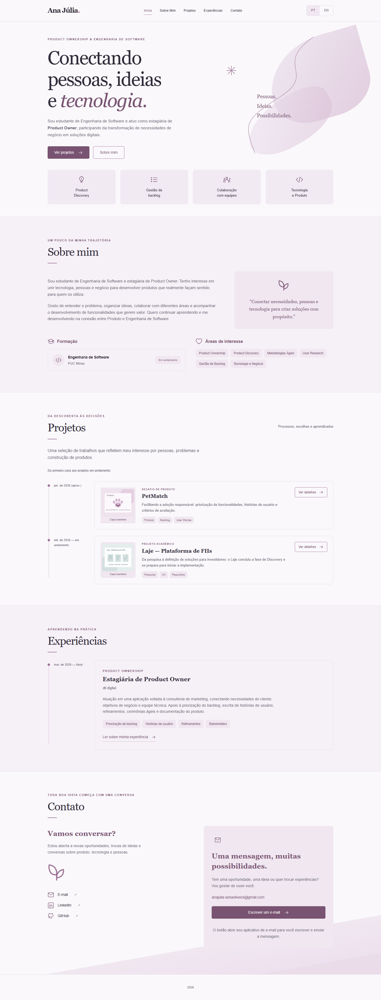
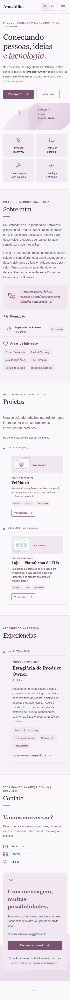

# Ana Júlia · Portfólio Profissional

Desenvolvi este portfólio para o **Laboratório 01 de Desenvolvimento e Integração de Aplicações Web (DIAW), da PUC Minas**. Meu objetivo é reunir minha apresentação pessoal, projetos, experiência profissional e formas de contato em uma aplicação web responsiva.

## Links úteis

- [Repositório do portfólio](https://github.com/Ana-Sena/DIAW-LAB01-Portfolio-Profissional)
- Aplicação local: http://127.0.0.1:5173
- [Site publicado na Vercel](https://ana-julia-portfolio-six.vercel.app/)
- [Protótipos e capturas](docs/PROTOTIPOS.md)
- [Checklist de entrega](docs/ENTREGA.md)

## Sobre o projeto

Construí uma aplicação web para apresentar minha trajetória como estudante de Engenharia de Software e estagiária de Product Owner. Em um só lugar, quem visita o site pode conhecer minha formação e meus interesses, ler meus estudos de caso, acompanhar minha experiência profissional e entrar em contato comigo.

Utilizei React com Vite, JavaScript e CSS para organizar as seções e páginas. Os projetos, experiências e textos dos cases ficam em arquivos JSON locais e são incorporados à aplicação. A timeline organiza os projetos por data, e uma página reutilizável apresenta os três relatos completos.

## Funcionalidades principais

- Menu com Início, Sobre Mim, Projetos, Experiências e Contato.
- Site completo em português e inglês com seletor PT/EN no cabeçalho e preferência salva no navegador.
- Timeline de projetos em ordem cronológica, com datas mensais e indicação de data aproximada quando necessário.
- Experiência profissional na dti digital e três páginas de case com índice e botão Voltar.
- Página 404 para rotas e cases inexistentes.
- Contato por e-mail, LinkedIn e GitHub, sem WhatsApp.
- Layout responsivo, labels de navegação, foco visível e link para pular ao conteúdo.

O botão **Escrever um e-mail** usa `mailto:` para abrir o aplicativo de correio do visitante. A mensagem é escrita e enviada nesse aplicativo. Não há envio automático pelo site nem formulário que simule sucesso.

## Tecnologias e dependências

| Finalidade      | Tecnologias                                         |
| --------------- | --------------------------------------------------- |
| Interface       | React 19, React DOM 19, JavaScript, HTML e CSS puro |
| Navegação       | React Router 7                                      |
| Desenvolvimento | Vite 7, `@vitejs/plugin-react` 5 e npm              |
| Conteúdo        | Arquivos JSON locais                                |
| Hospedagem      | Vercel                                              |

Registrei as versões exatas das dependências no `frontend/package-lock.json`. As ferramentas em `tools/` são auxiliares e não são necessárias para executar ou hospedar o portfólio.

## Estrutura de pastas

```text
docs/
  figma-assets/              # Capas utilizadas na exportação ao Figma
  screenshots/               # Capturas da aplicação e dos protótipos
  ENTREGA.md                 # Checklist de entrega
  PROTOTIPOS.md              # Links e informações dos protótipos
  browser-check.json         # Registro da verificação no navegador
  wireframes.svg             # Wireframes do portfólio
frontend/
  public/images/             # Capas ilustrativas SVG e favicon
  src/
    components/              # Header, Footer, Timeline, ProjectCard e ícones
    data/                    # Cases e experiências em PT/EN, além dos contatos
    i18n/                    # Estado global do idioma e traduções da interface
    sections/                # Hero, About, Projects, Experiences e Contact
    pages/                   # Home, CaseDetail e NotFound
    services/                # Acesso ao conteúdo local e formatação de datas
    styles/                  # CSS global e layout responsivo
    App.jsx
    main.jsx
  .env.example               # Contatos públicos opcionais
  index.html
  package.json
  package-lock.json
  vite.config.js
  vercel.json
tools/                       # Ferramentas locais auxiliares
.gitattributes
.gitignore
README.md
```

Omiti as pastas geradas automaticamente, como `node_modules/` e `dist/`.

## Instalação e execução

Utilizo **Node 22.12+** e npm. Validei o desenvolvimento com Node 24. A partir da raiz do repositório, executo em um único terminal:

```powershell
cd frontend
npm.cmd ci
npm.cmd run dev
```

Depois, abro http://127.0.0.1:5173. Nas próximas execuções, basta entrar em `frontend` e executar `npm.cmd run dev`. Encerro a aplicação com `Ctrl + C`.

No Windows, utilizo `npm.cmd` para evitar bloqueios de execução de `npm.ps1`. Em outros sistemas, posso usar `npm`. Não preciso iniciar outro processo ou liberar a porta 8080.

## Tradução e conteúdo

Disponibilizei a tradução completa pelo seletor **PT / EN** no cabeçalho, inclusive nas páginas dos cases. A escolha se mantém ao navegar e recarregar a página. Também adaptei as datas, os textos das capas, os títulos das páginas e as descrições de acessibilidade.

Organizei o idioma com React Context e arquivos locais, sem precisar de API de tradução, chave de acesso ou novas dependências. Para atualizar os textos, mantenho as duas versões:

- Interface: textos em português nos componentes e traduções em `frontend/src/i18n/en.json`.
- Cases: `frontend/src/data/cases.json` e `cases.en.json`.
- Experiência profissional: `frontend/src/data/experiences.json` e `experiences.en.json`.
- Apresentação pessoal: versões `pt` e `en` em `frontend/src/sections/About.jsx`.
- Capas ilustrativas: arquivos SVG em `frontend/public/images/`, com sufixo `.en.svg` para inglês.

Mantenho os mesmos identificadores dos cases (`slug` e `caseSlug`) nos dois idiomas, para preservar os links e compartilhar datas e demais dados comuns.

## Demonstração e protótipos





Disponibilizei os [wireframes e as telas exportadas ao Figma](docs/PROTOTIPOS.md), sem publicar os materiais de referência. As capturas de execução mostram a versão atual; as telas Figma registram uma versão anterior à simplificação da área de contato.

## Documentação

[Vite](https://vite.dev/guide/), [React](https://react.dev/), [React Router](https://reactrouter.com/) e [Vite na Vercel](https://vercel.com/docs/frameworks/frontend/vite).
