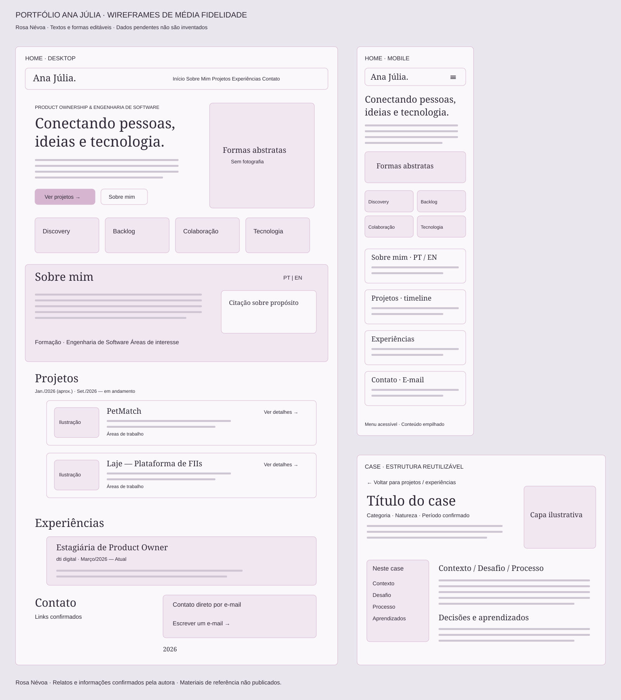

# Protótipos e referências visuais

Direção aprovada: Rosa Névoa, layout minimalista, editorial e responsivo; títulos em Georgia, corpo em Arial, sem fotografia.

O conteúdo foi atualizado com datas mensais e contatos confirmados pela autora. Documentos de referência, mockups de terceiros e materiais com contribuições de outras pessoas ficam apenas no ambiente local e não são publicados.

## Wireframes locais

[Prancha editável em SVG](wireframes.svg): home desktop, home mobile e estrutura de case. Abra no navegador ou importe o SVG no Figma. Textos e formas são vetoriais; não é uma captura achatada da interface.

## Figma

As telas abaixo registram a versão exportada antes da conversão para uma aplicação sem backend. Na versão atual, a área de contato foi simplificada para links e um botão que abre o aplicativo de e-mail, e o rodapé mostra apenas o ano. As capturas de execução nesta pasta foram atualizadas; o arquivo Figma permanece como referência da versão anterior.

O conteúdo atualizado foi enviado, após autorização explícita da autora, ao [arquivo Portfólio Ana Júlia — Rosa Névoa](https://www.figma.com/design/MkxSPhjuEX5o1OHzdr2GCW?node-id=6-2). Há quatro telas organizadas lado a lado, com textos e hierarquia editáveis; não são imagens achatadas das páginas. Os documentos de referência não foram enviados.

| Tela     | Link                                                                      | Textos / vetores |
| -------- | ------------------------------------------------------------------------- | ---------------- |
| Home     | [Abrir](https://www.figma.com/design/MkxSPhjuEX5o1OHzdr2GCW?node-id=6-2)  | 90 / 30          |
| PetMatch | [Abrir](https://www.figma.com/design/MkxSPhjuEX5o1OHzdr2GCW?node-id=9-2)  | 57 / 1           |
| Laje     | [Abrir](https://www.figma.com/design/MkxSPhjuEX5o1OHzdr2GCW?node-id=11-2) | 85 / 1           |
| dti digital      | [Abrir](https://www.figma.com/design/MkxSPhjuEX5o1OHzdr2GCW?node-id=13-2) | 61 / 1           |

As únicas imagens preenchidas nas telas são as capas ilustrativas dos cases. Símbolos decorativos que o Figma interpretou como emojis foram substituídos por vetores. A captura é ativada somente em desenvolvimento, por uma URL explícita com `#figmacapture=...`; o script externo não é carregado na versão de produção nem na navegação local comum.

As capas SVG foram rasterizadas localmente apenas para o Figma, corrigindo caracteres que o conversor remoto não renderizou. O site mantém os SVGs originais. As quatro telas exportadas foram conferidas visualmente; as capturas estão em `screenshots/figma-*.png`.

**Limitação verificada:** Georgia e Arial foram preservadas nas propriedades dos textos, mas não estão disponíveis no runtime remoto do Figma. A exportação de conteúdo foi concluída; a fidelidade visual e a edição tipográfica no Figma dependem de acesso às fontes locais. Não foi criada uma biblioteca de componentes publicada. O site continua usando as fontes de sistema especificadas, sem alterações.

## Capturas da implementação real

- [Desktop, 1440px](screenshots/home-1440.png)
- [Tablet, 768px](screenshots/home-768.png)
- [Celular, 360px](screenshots/home-360.png)
- [PetMatch](screenshots/case-petmatch.png)
- [Laje — Plataforma de FIIs](screenshots/case-fiis.png)
- [Experiência profissional](screenshots/case-experiencia-po.png)
- [Case em celular](screenshots/case-mobile.png)

As capas dos cases são ilustrações vetoriais identificadas como ilustrativas. Não representam aplicações implementadas. Os PDFs de referência não são servidos pelo frontend; não há dados de participantes de pesquisa nas imagens públicas.
